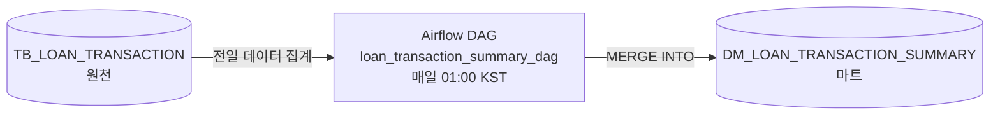

# 여신 거래 일별 집계 ETL 파이프라인

여신(대출) 거래 원천 데이터를 **거래일자 × 상품코드** 단위로 집계해 Oracle 데이터마트에 적재하는 Airflow 파이프라인입니다. Docker Compose 기반의 로컬 개발·검증 환경입니다.



- **스케줄**: 매일 01:00 KST에 전일(KST) 하루치를 처리합니다.
- **원천 대기**: `SqlSensor`가 처리할 일자의 원천 데이터가 들어올 때까지 최대 3시간 기다립니다.
- **증분 적재**: 해당 일자만 집계해 `MERGE INTO`로 Upsert합니다. 재실행해도 결과가 같습니다(멱등).

## 기술 스택

| 구분 | 구성 |
|---|---|
| 오케스트레이터 | Apache Airflow 2.8.1 (Python 3.10, LocalExecutor) |
| 대상 DB | Oracle Database Free (PDB `FREEPDB1`) |
| 메타데이터 DB | PostgreSQL 13 |
| 실행 환경 | Docker Desktop + Docker Compose (Windows/WSL2에서 검증) |

## 빠른 시작

명령은 Windows PowerShell 기준입니다. 프로젝트 루트에서 실행하세요.

### 1. 환경 변수 파일 준비

```powershell
cp .env.example .env
```

`.env`를 열어 값을 채웁니다.

| 변수 | 설명 |
|---|---|
| `ORACLE_PWD` | Oracle `SYSTEM` 계정 비밀번호 |
| `POSTGRES_PASSWORD` | Airflow 메타데이터 DB 비밀번호 |
| `FERNET_KEY` | 아래 명령으로 생성한 값 |
| `AIRFLOW_CONN_ORACLE_DEFAULT` | JSON 안의 `<ORACLE_PWD>`를 `ORACLE_PWD`와 같은 값으로 바꿈 |

```powershell
# Fernet Key 생성
docker run --rm apache/airflow:2.8.1-python3.10 python -c "from cryptography.fernet import Fernet; print(Fernet.generate_key().decode())"
```

> `.env`는 `.gitignore`에 등록되어 있어 커밋되지 않습니다. 값이 비어 있으면 `docker compose`가 기동을 거부합니다.

### 2. Airflow 초기화 (최초 1회)

메타데이터 DB에 테이블을 만들고 웹 로그인 계정을 생성합니다. 이 결과는 Docker 볼륨에 저장되므로 **처음 한 번만** 실행하면 됩니다.

```powershell
docker compose run --rm airflow-webserver airflow db migrate
docker compose run --rm airflow-webserver airflow users create --username admin --password admin --firstname Admin --lastname User --role Admin --email admin@example.com
```

### 3. 전체 기동

```powershell
docker compose up -d
docker logs -f oracle-db   # "DATABASE IS READY TO USE!"가 나오면 Ctrl+C
```

처음 기동할 때 Oracle DB 생성에 수 분이 걸립니다. Airflow 컨테이너도 기동할 때마다 Oracle Provider를 설치하므로 1~2분 뒤에 접속됩니다.

### 4. 원천 테이블 생성

```powershell
docker cp sql/ddl/tb_loan_transaction.sql oracle-db:/tmp/
docker exec oracle-db sqlplus -s "system/<ORACLE_PWD>@FREEPDB1" "@/tmp/tb_loan_transaction.sql"
```

마트 테이블(`DM_LOAN_TRANSACTION_SUMMARY`)은 DAG가 처음 실행될 때 자동으로 생성됩니다.

### 5. 샘플 데이터 추가 (필수)

> ⚠ **이 저장소에는 샘플 데이터가 포함되어 있지 않습니다.** 원천 테이블이 비어 있으면 Sensor가 3시간 동안 기다린 뒤 실패하므로, DAG를 실행하기 전에 **처리할 일자의 원천 데이터를 직접 넣어야 합니다.**

DBeaver 같은 SQL 클라이언트(`localhost:1521/FREEPDB1`, `SYSTEM` 계정)로 접속해 아래 형식으로 입력합니다. `TX_SEQ`는 자동 채번되므로 넣지 않습니다.

```sql
INSERT INTO SYSTEM.TB_LOAN_TRANSACTION (TX_DATE, CUST_ID, PRODUCT_CODE, TX_TYPE, TX_AMOUNT)
VALUES ('20261004', 'CUST0001', 'LN1001', 'NEW', 15000000);   -- TX_TYPE: NEW / REPAY / INTEREST
COMMIT;
```

`TX_DATE`는 DAG가 처리할 **배치 기준일자**와 같아야 합니다. 기준일자를 정하는 방식은 아래 6번을 참고하세요.

### 6. DAG 실행

1. `http://localhost:8080`에 2번에서 만든 계정으로 로그인합니다.
2. `loan_transaction_summary_dag`는 **일시정지 상태로 등록**되므로 토글을 켜서 활성화합니다.
3. 수동 실행(Trigger)하면 **직전에 끝난 구간(전일 KST)**을 처리합니다.

| 실행 방식 | 처리하는 기준일자 |
|---|---|
| 정기 실행 (매일 01:00 KST) | 전일 |
| 수동 실행 (Trigger) | 실행 시각 기준 직전에 끝난 구간의 날짜 (예: 10/05 17:40 실행 → `20261004`) |
| 특정 일자 재처리 | `airflow dags backfill`에 KST 시각 지정 ([문서 4.2절](docs/ARCHITECTURE.md#42-배치-기준일자)) |

## 디렉터리 구조

```
├── dags/loan_summary_dag.py        # ETL DAG
├── sql/ddl/                        # 원천 테이블 DDL
├── backup/export_source.sql        # 원천 데이터 → INSERT 문 추출 스크립트
├── docs/
│   ├── ARCHITECTURE.md             # 아키텍처·스키마·운영 문서
│   └── worklog/                    # 일자별 작업 로그
├── docker-compose.yml
└── .env.example                    # 환경 변수 템플릿
```

## 운영 시 주의사항

- **`docker compose down -v`는 사용하지 마세요.** Oracle 데이터와 Airflow 메타데이터가 저장된 볼륨이 삭제됩니다. 중지·재시작은 `docker compose stop`/`start` 또는 `down`/`up -d`를 사용합니다.
- **`catchup=False`입니다.** 컨테이너가 꺼져 있던 동안 놓친 구간은 다시 켤 때 **가장 최근 구간 하나만** 실행됩니다. 나머지는 Backfill로 처리합니다.
- **`FERNET_KEY`를 바꾸지 마세요.** 메타데이터 DB에 저장된 비밀번호를 복호화할 수 없게 됩니다.

## 문서

- [ARCHITECTURE.md](docs/ARCHITECTURE.md): 시스템 구성, 데이터 파이프라인, 스키마, 운영 고려사항, 향후 고도화 방향
- [작업 로그](docs/worklog/): 일자별 변경 내역과 트러블슈팅 기록
